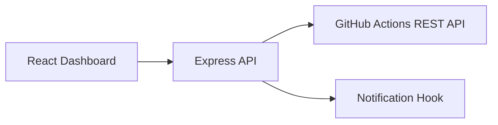

# Deployment Monitor

A small full-stack dashboard for tracking **GitHub Actions deployment workflows across multiple repositories** in one place.

The frontend is React/Vite. A tiny Node/Express API keeps GitHub credentials server-side and converts GitHub workflow-run data into a stable dashboard contract.

## Features

- Multi-repository deployment overview
- Latest GitHub Actions workflow status
- Branch, actor, run number, and timestamps
- Manual refresh
- Optional webhook-style completion notification hook
- Server-side GitHub token handling
- Mock mode for screenshots and demos

## Architecture



## Quick start

### Backend

```bash
cd server
cp .env.example .env
npm install
npm run dev
```

### Frontend

```bash
cd client
npm install
npm run dev
```

Frontend: `http://localhost:5173`  
API: `http://localhost:3001`

## Configuration

`server/.env`

```env
PORT=3001
GITHUB_TOKEN=
REPOSITORIES=owner/repo-one,owner/repo-two,owner/repo-three
MOCK_MODE=true
NOTIFY_WEBHOOK_URL=
```

Use `MOCK_MODE=true` for a zero-credential portfolio demo.

## Security note

Never put a GitHub token in Vite/browser environment variables. This project keeps it on the server.

## Portfolio note

This implementation uses synthetic repository names in mock mode. Replace them with repositories you own or have permission to query.
